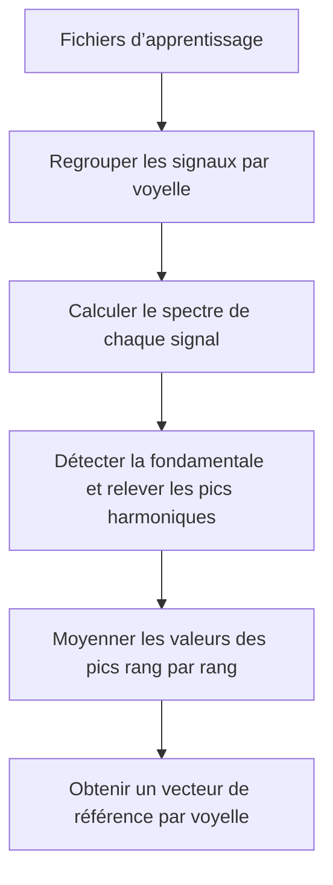
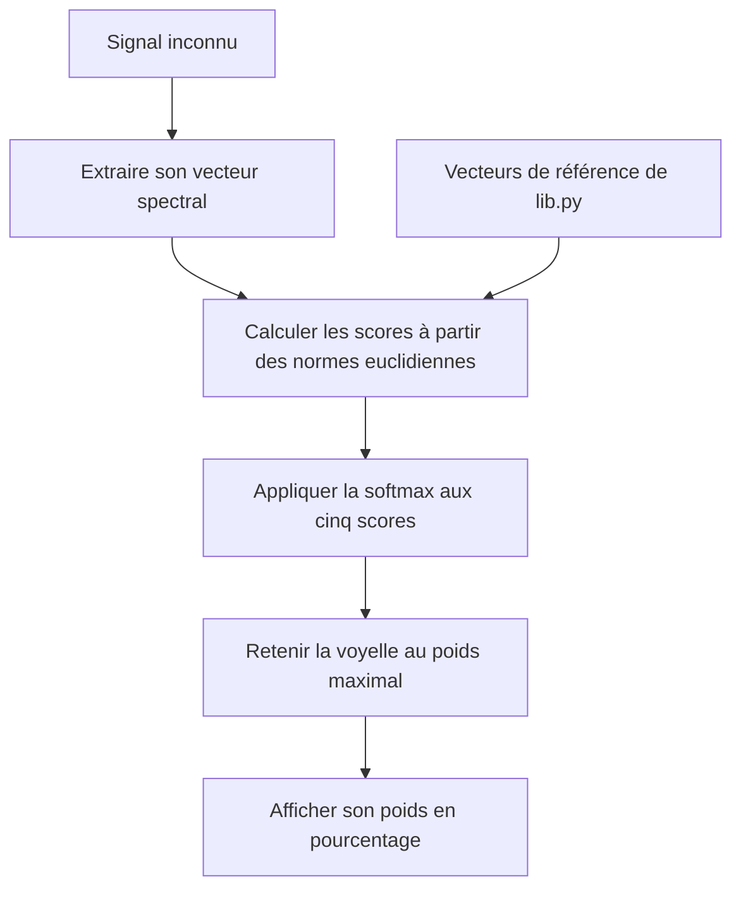
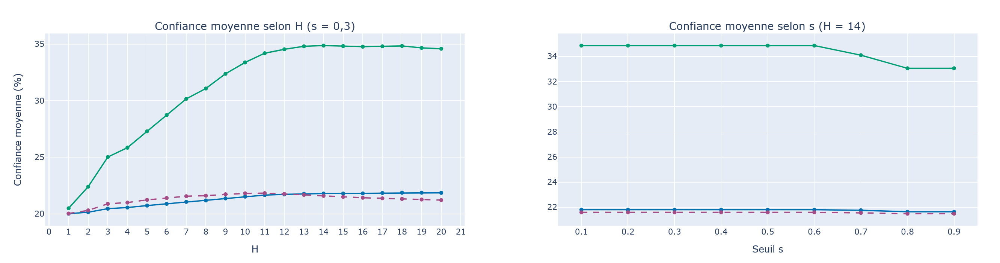
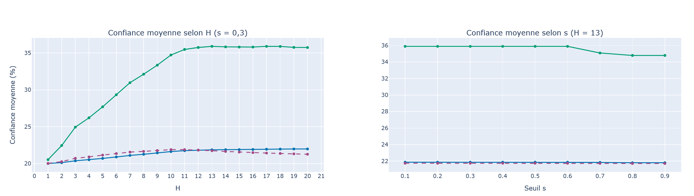

# Prédiction de voyelles

> TP 2 SAN · 3ETI · CPE Lyon

**Auteurs** — Tristan GUIEU, Nino BELAOUD

Ce projet classe un enregistrement dans l’une des cinq voyelles `a`, `e`, `i`, `o` et `u` à partir de son spectre.

## Exécution

Utiliser l’environnement Python MSI CPE du TP avec NumPy, le module `msicpe.san` et Plotly pour l’affichage des figures. Exécuter les commandes depuis la racine du dépôt.

| Commande | Comportement |
| --- | --- |
| `python predict.py` | Demande le chemin d’un fichier `.npz`, par exemple `data/test/a_6.npz`, puis affiche la voyelle prédite et sa confiance relative. |
| `python test.py` | Compare, pour chaque fichier de `data/test`, la prédiction à la voyelle indiquée dans le nom du fichier. |
| `python train.py` | Recalcule les références à partir de `data/apprentissage`, les affiche en console et ouvre une figure Plotly vide par voyelle. |
| `python test_parameters.py` | Recalcule les références pour chaque réglage et trace le taux de prédictions correctes et la confiance moyenne pour quatre méthodes de score. |

`predict.py` et `test.py` utilisent directement les références définies dans `lib.py`. Les vecteurs recalculés par `train.py` sont conservés en mémoire pendant son exécution.

## Données

Chaque fichier `.npz` contient le signal `s` et le vecteur temps `t`.

| Dossier | Contenu |
| --- | --- |
| `data/apprentissage` | 25 enregistrements étiquetés, soit 5 par voyelle. |
| `data/test` | 10 enregistrements étiquetés, soit 2 par voyelle. |
| `data/etude` | 15 signaux d’étude nommés `signal_1.npz` à `signal_15.npz`. |

`train.py` et `test.py` regroupent les fichiers de leur dossier par voyelle, à partir du préfixe devant le premier `_` dans chaque nom.

## Extraction et apprentissage

La transformée de Fourier donne un spectre dont le module au carré est noté $P$. La fréquence fondamentale $f_1$ est détectée sur $P / \max(P)$ avec un seuil de `0.3` par défaut. Les valeurs des pics sont relevées dans le spectre logarithmique $\log_{10}(P) / \max(\log_{10}(P))$, autour des fréquences $h f_1$ pour $h = 1, \ldots, H+1$.

À l’apprentissage, chaque composante du vecteur de référence d’une voyelle est la moyenne des valeurs relevées au même rang dans ses enregistrements. Avec `H = 14`, le vecteur contient 15 composantes, de la fondamentale aux 14 harmoniques suivantes.

Chaque colonne reprend un vecteur défini dans [`lib.py`](lib.py), arrondi à quatre décimales. Le rang 1 correspond à la fondamentale.

| Rang | a | e | i | o | u |
| ---: | ---: | ---: | ---: | ---: | ---: |
| 1 | 0,9927 | 0,9709 | 0,9878 | 0,9231 | 0,9990 |
| 2 | 0,9504 | 0,9713 | 0,9505 | 0,9827 | 0,9376 |
| 3 | 0,7306 | 0,8103 | 0,6360 | 0,9700 | 0,6286 |
| 4 | 0,8092 | 0,9111 | 0,3983 | 0,7906 | 0,4142 |
| 5 | 0,7819 | 0,6495 | 0,2265 | 0,5776 | 0,3276 |
| 6 | 0,8789 | 0,5345 | 0,2120 | 0,5939 | 0,2392 |
| 7 | 0,8140 | 0,5097 | 0,1358 | 0,3628 | 0,1221 |
| 8 | 0,7859 | 0,4942 | 0,0430 | 0,2288 | 0,0948 |
| 9 | 0,7255 | 0,4053 | 0,0200 | 0,1441 | 0,1080 |
| 10 | 0,6634 | 0,4741 | -0,0344 | 0,1015 | 0,1044 |
| 11 | 0,7660 | 0,4764 | -0,0107 | 0,0777 | 0,2047 |
| 12 | 0,5816 | 0,3601 | -0,0096 | 0,0426 | 0,3204 |
| 13 | 0,4255 | 0,2674 | 0,0046 | 0,0348 | 0,2843 |
| 14 | 0,3192 | 0,2991 | 0,0596 | 0,0184 | 0,2707 |
| 15 | 0,2328 | 0,2263 | 0,1525 | 0,0166 | 0,2128 |

## Prédiction

Le vecteur du signal inconnu est extrait de la même façon que les vecteurs d’apprentissage. Par défaut, la méthode `NE` calcule la **norme euclidienne** de la différence entre le vecteur inconnu $\mathbf{x}$ et le vecteur de référence $\mathbf{r}_v$ de chaque voyelle. Le score est l’opposé de cette norme, de sorte que la voyelle la plus proche obtient le score le plus élevé.

$$
s_v = -\lVert \mathbf{x} - \mathbf{r}_v \rVert_2
$$

La softmax transforme les cinq scores en poids relatifs dont la somme vaut 1. Soustraire le score maximal stabilise le calcul.

$$
m = \max_{u \in V} s_u,
\qquad
w_v = \frac{\exp(s_v - m)}{\sum_{u \in V} \exp(s_u - m)},
\qquad V = \{a,e,i,o,u\}
$$

La voyelle au poids maximal est retenue. Le script affiche ce poids en pourcentage sous le nom **Confiance relative (softmax)**. Avec cinq scores identiques, chaque voyelle obtient 20 %.

## Étude des paramètres

`test_parameters.py` fait varier $H$ de 1 à 20 à seuil fixe $s = 0{,}3$, puis le seuil de 0,1 à 0,9 par pas de 0,1 à $H = 13$. Le script compare quatre scores.

| Méthode | Calcul du score |
| --- | --- |
| `NE` (par défaut) | Opposé de la norme euclidienne de la différence des vecteurs. |
| `PSN` | Produit scalaire des vecteurs normalisés, soit la similarité cosinus. |
| `PS` | Produit scalaire des vecteurs. |
| `MSE` | Opposé de l’erreur quadratique moyenne. |

Les courbes intitulées « Précision » montrent le pourcentage de prédictions correctes. La confiance moyenne est la moyenne des poids softmax des voyelles prédites, exprimée en pourcentage.

**Le balayage utilise `data/apprentissage` pour calculer les références et `data/test` pour mesurer les résultats.** Ces courbes décrivent donc les performances sur les enregistrements d’apprentissage. Le script `test.py` utilise les dix enregistrements distincts de `data/test`.

