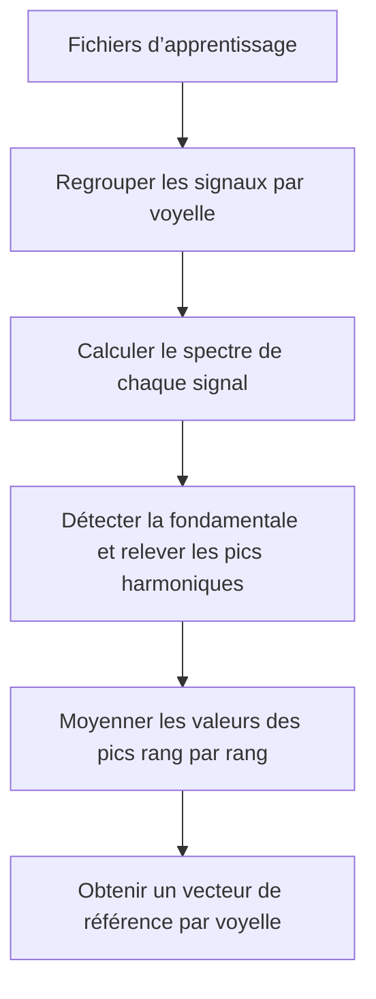
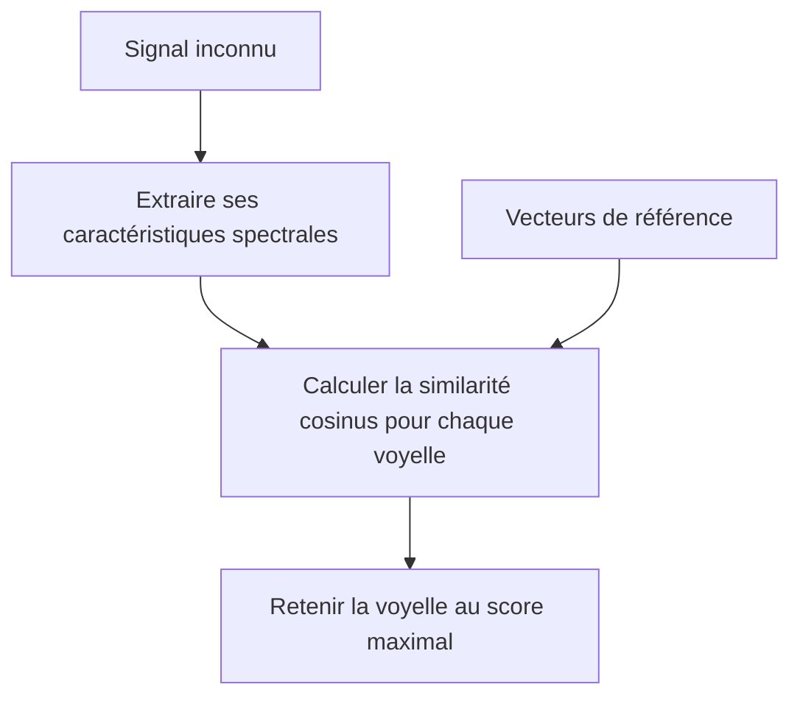

# Prédiction de voyelles

> TP 2 SAN - 3ETI - CPE Lyon

**__Auteur:__** **Tristan GUIEU, Nino BELAOUD**

**__Environement Python:__** **MSI CPE**

## Principe de fonctionnement

### Entrainement

Le but de l'entrainement est de calculer le vecteur caractérisant chaque lettre.

Chaque lettre possède un vecteur est de dimension H+1 composée des amplitudes moyennes du fondamentales et des H premier harmonique des signaux de la lettre contenu dans `data/apprentissage`.

$$
\mathbf{r}_v = (r_{v,1}, \ldots, r_{v,H+1}),
\qquad
r_{v,h} = \frac{1}{J_v} \sum_{j=1}^{J_v} A_{v,j,h}
$$

$J_v$ désigne le nombre d’enregistrements de la voyelle $v$ et $A_{v,j,h}$
la valeur du pic de rang $h$ dans le spectre logarithmique normalisé de
l’enregistrement $j$. Le rang $h=1$ correspond à la fondamentale.

Nous obtenons les vecteurs suivants:

Chaque colonne reprend un vecteur utilisé dans `test.py`, arrondi à quatre
décimales. Le numéro de ligne $h$ indique le rang de l’harmonique.

$$
\begin{array}{r|rrrrr}
h & a & e & i & o & u \\
\hline
1 & 0{,}9927 & 0{,}9709 & 0{,}9878 & 0{,}9433 & 0{,}9990 \\
2 & 0{,}9504 & 0{,}9713 & 0{,}9505 & 0{,}9463 & 0{,}9376 \\
3 & 0{,}7306 & 0{,}8103 & 0{,}6360 & 0{,}8813 & 0{,}6286 \\
4 & 0{,}8092 & 0{,}9111 & 0{,}3983 & 0{,}6735 & 0{,}4142 \\
5 & 0{,}7819 & 0{,}6495 & 0{,}2265 & 0{,}4739 & 0{,}3276 \\
6 & 0{,}8789 & 0{,}5345 & 0{,}2120 & 0{,}4987 & 0{,}2392 \\
7 & 0{,}8140 & 0{,}5097 & 0{,}1358 & 0{,}3188 & 0{,}1221 \\
8 & 0{,}7859 & 0{,}4942 & 0{,}0430 & 0{,}1843 & 0{,}0948 \\
9 & 0{,}7255 & 0{,}4053 & 0{,}0200 & 0{,}1201 & 0{,}1080 \\
10 & 0{,}6634 & 0{,}4741 & -0{,}0344 & 0{,}0777 & 0{,}1044 \\
11 & 0{,}7660 & 0{,}4764 & -0{,}0107 & 0{,}0977 & 0{,}2047 \\
12 & 0{,}5816 & 0{,}3601 & -0{,}0096 & 0{,}0387 & 0{,}3204 \\
13 & 0{,}4255 & 0{,}2674 & 0{,}0046 & 0{,}0661 & 0{,}2843 \\
14 & 0{,}3192 & 0{,}2991 & 0{,}0596 & 0{,}0122 & 0{,}2707 \\
15 & 0{,}2328 & 0{,}2263 & 0{,}1525 & 0{,}0146 & 0{,}2128 \\
16 & 0{,}1874 & 0{,}2484 & 0{,}1222 & 0{,}0103 & 0{,}1573 \\
17 & 0{,}1508 & 0{,}2284 & 0{,}0187 & -0{,}0182 & 0{,}0455 \\
18 & 0{,}1936 & 0{,}2197 & -0{,}0060 & -0{,}0262 & -0{,}0375 \\
19 & 0{,}1338 & 0{,}2169 & -0{,}0176 & 0{,}0526 & 0{,}0181 \\
20 & 0{,}1702 & 0{,}2083 & -0{,}0354 & 0{,}1019 & -0{,}0034 \\
21 & 0{,}2089 & 0{,}2302 & 0{,}0476 & 0{,}0666 & 0{,}0754
\end{array}
$$

## Prediction

Le but de la prédiction est de trouver à quel lettre un signal inconnu correspond.

Pour cela il faut trouver calculer le score de similitude entre le **vecteur du signal inconnu** et chaque **vecteur des lettres connues**.

La lettre détecté étant celle avec le score de similitude le plus élevé.

Nous avons choisit de définir le score de similitude par le **produit scalaire** entre le **vecteur inconnu normalisé** et le **vecteur connu normalisé**

Pour le vecteur $\mathbf{x}$ du signal inconnu et le vecteur de référence
$\mathbf{r}_v$ de la voyelle $v$, le score de similarité cosinus vaut

$$
s_v = \frac{\mathbf{x} \cdot \mathbf{r}_v}
{\lVert \mathbf{x} \rVert_2\,\lVert \mathbf{r}_v \rVert_2}.
$$

On choisit ensuite celui avec le plus grand score.

